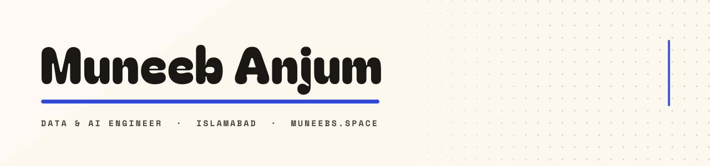

<div align="center">

<picture>
  <source media="(prefers-color-scheme: dark)" srcset="assets/banner-dark.svg">
  <source media="(prefers-color-scheme: light)" srcset="assets/banner-light.svg">
  
</picture>

**I build the measurement tools I kept needing and couldn't find.**

[`muneebs.space`](https://muneebs.space) · [`ORCID`](https://orcid.org/0009-0001-2042-7656) · [`LinkedIn`](https://www.linkedin.com/in/tmuneebanjum) · [`@turing`](https://www.turing.com)

</div>

---

## Open source

Four packages I maintain end to end — tests, docs, CI, and a release I can point at.

| Package | What it does | Release |
|:--|:--|:--|
| **[datasets&#8209;lint](https://pypi.org/project/datasets-lint/)** | `ruff` for training data — duplicates, PII, eval-set contamination, schema drift, label leakage, with `--fix` codemods and SARIF output | [](https://pypi.org/project/datasets-lint/) [](https://github.com/horizonbymuneeb/datasets-lint/actions/workflows/ci.yml) |
| **[naqsha&#8209;cli](https://www.npmjs.com/package/naqsha-cli)** | Architecture diagrams as code — lint, JSON schema, static export, and a self-contained viewer with zoom and copy-PNG | [](https://www.npmjs.com/package/naqsha-cli) [](https://github.com/horizonbymuneeb/naqsha/actions/workflows/ci.yml) |
| **[refilm](https://www.npmjs.com/package/refilm)** | Visual regression for DOM state — SVG+PNG frames, `watch` loop for development, `accept` to promote baselines with an audit trail | [](https://www.npmjs.com/package/refilm) [](https://github.com/horizonbymuneeb/refilm/actions/workflows/ci.yml) |
| **[relabeld](https://www.npmjs.com/package/relabeld)** | Deterministic re-labelling for annotated screenshots — recipes, diff reports, screenshot evidence in CI | [](https://www.npmjs.com/package/relabeld) [](https://github.com/horizonbymuneeb/relabel/actions/workflows/ci.yml) |

**On GitHub Marketplace** — the same tools, running where the code already is:

<div align="center">
  <a href="https://github.com/marketplace/actions/naqsha-diagrams"></a>
  <a href="https://github.com/marketplace/actions/refilm-verify"></a>
  <a href="https://github.com/marketplace/actions/relabel-verify"></a>
</div>

<p align="center"><sub>4 packages · 3 Marketplace Actions · 500+ tests · 92% coverage on datasets-lint</sub></p>

---

## What I work on

```console
muneeb@horizon ~ $ cat focus.txt
> LLM security        prompt injection, quantisation-induced attack surface
> Evaluation           benchmarks that report what aggregate accuracy hides
> Quantisation         what survives compression, and what silently flips
> Product engineering  Chrome extensions, MCP servers, self-hosted tools
```

## Research

| Paper | What it measures | |
|:--|:--|:--|
| **Quantized Guardians** — Accuracy-Neutral Decision Churn in Compressed Prompt-Injection Detectors | F1/AUROC hold steady while *which* inputs get blocked flips | [DOI](https://doi.org/10.5281/zenodo.23210534) |
| **Same Accuracy, Different Verdicts** — Quantization-Induced Verdict Churn in Small LLM Smart-Contract Auditors | 175 Solidity contracts, F16 → Q8_0 → Q4_K_M, up to 45.7% verdict flips | [DOI](https://doi.org/10.5281/zenodo.23241640) |
| **SENTINEL-LLM** — Practical Multi-Layer Defense for Adversarial Prompts | 7 PoC prompts, 32 real attacks (JailbreakBench / HarmBench / OWASP) | [preprint + code](https://github.com/horizonbymuneeb/sentinel-llm) |
| **TokenAttackKit** — Unicode-Level Tokenization Attack Detection | 11 attack families, 0.98 F1 heuristic detector, CPU-only | [code](https://github.com/horizonbymuneeb/tokenization-attack-kit) |

## Selected projects

| Project | Stack | Description |
|:--|:--|:--|
| **[localbench](https://github.com/horizonbymuneeb/localbench)** | `Python` `FastAPI` | Benchmark console for local LLM servers — TTFT, prefill/decode tok/s across 1K–64K contexts, concurrency sweeps, GPU telemetry |
| **[pin-saver](https://github.com/horizonbymuneeb/pin-saver)** | `JavaScript` `MV3` | Download a whole Pinterest board as ZIP or PDF — zero dependencies, [live on the Chrome Web Store](https://chromewebstore.google.com/detail/pin-saver-pinterest-board/jdfjeiajmielkjbeoafnekpppdlpjkeg) |
| **[linkedin-mcp-pro](https://github.com/horizonbymuneeb/linkedin-mcp-pro)** | `Python` `MCP` `Playwright` | MCP server exposing 54 LinkedIn tools to any agent runtime |
| **[llm-quantization-benchmarks](https://github.com/horizonbymuneeb/llm-quantization-benchmarks)** | `Python` | Accuracy delta, per-input decision churn and per-layer sensitivity across FP32/BF16/INT8/INT4 |
| **[agentic-rag-pipeline](https://github.com/horizonbymuneeb/agentic-rag-pipeline)** | `Python` | Hybrid BM25 + dense retrieval, reciprocal rank fusion, query rewriting, grounding checks |
| **[tinyllm-eval-suite](https://github.com/horizonbymuneeb/tinyllm-eval-suite)** | `Python` | Reproducible eval harness for small models — task suites, scoring, regression tracking |

<details>
<summary><sub>Engineering breadth — 10 more repos</sub></summary>

```
speech-to-text-pipeline   time-series-anomaly      fraud-detection-system
neural-architecture-search mlops-experiment-tracking synthetic-data-generator
multimodal-vlm-training   medical-imaging-diagnosis autonomous-rl-agent
edge-vision-tensorrt
```

</details>

---

## Books

**Practical AI Security Series** — Kindle · Paperback

`01` Quantum Computing with AI · `02` LLM Security and Prompt Injection<br>
`03` AI and Blockchain · `04` AI and Cyber Security

## Stack

```console
muneeb@horizon ~ $ cat stack.toml
[core]
python = "primary — PyTorch, FastAPI, numpy"
js     = "TypeScript, Chrome MV3, React"
infra  = "Linux, systemd, Nginx, Docker, Cloudflare"

[ai]
models = "transformers, llama.cpp, vLLM, quantization tooling"
agents = "MCP, tool-calling, RAG, evaluation harnesses"
```

<div align="center">

<sub>Writing code, then measuring what it actually does.</sub>

[`muneebs.space`](https://muneebs.space) · [`GitHub`](https://github.com/horizonbymuneeb) · [`ORCID`](https://orcid.org/0009-0001-2042-7656) · [`LinkedIn`](https://www.linkedin.com/in/tmuneebanjum)

</div>
